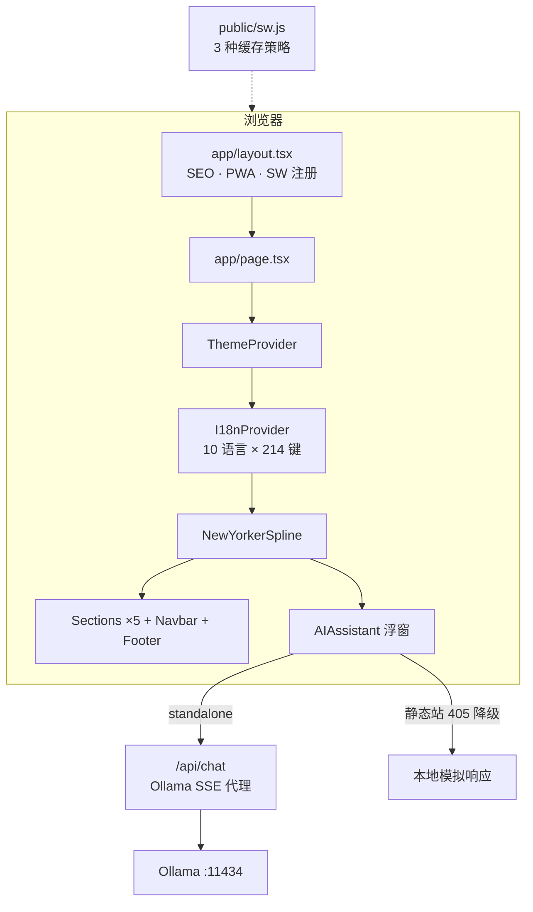

<div align="center">

# 🧊 YYC³ Nexus Portal

**言渝云枢 · 智能交互门户** · *YYC³ AI Family 3D Interactive Showcase*

[](https://portal.yyc3.top)

---

[](https://github.com/YYC-Cube)
[](https://github.com/YYC-Cube/YYC3-Nexus-Portal/actions/workflows/ci.yml)
[](https://github.com/YYC-Cube/YYC3-Nexus-Portal/actions/workflows/codeql.yml)
[](https://nextjs.org/)
[](https://react.dev/)
[](https://www.typescriptlang.org/)
[](https://tailwindcss.com/)
[](https://www.framer.com/motion/)
[](https://zod.dev/)
[](https://spline.design/)

[](LICENSE)
[](SECURITY.md)
[](https://portal.yyc3.top)
[](https://docker.com)
[](https://web.dev/progressive-web-apps/)
[](https://github.com/YYC-Cube)
[](https://nodejs.org/)
[](https://pnpm.io/)
[](CONTRIBUTING.md)

🌐 **[portal.yyc3.top](https://portal.yyc3.top)** · 📦 **[v0.2.0](CHANGELOG.md)** · 📖 **[Dev Guide](docs/DEVELOPER.md)**

---

</div>

<!-- ======================================================================== -->
<!-- 🇨🇳 中文版本 -->
<!-- ======================================================================== -->

<details open>
<summary><strong>🇨🇳 中文文档</strong> <code>默认</code></summary>
<br />

## ✦ 项目简介

**YYC³ Nexus Portal** 是 [YanYuCloudCube](https://github.com/YYC-Cube) 团队打造的 AI 智能交互门户，以 **「五高五标五化五维」** 核心框架为驱动，融合 Spline 3D 沉浸式场景、10 语言国际化、Ollama 本地 AI 推理等前沿技术，构建面向 AI 时代的智能应用展示范式。

> **核心理念** — *言启象限，语枢未来。万象归元于云枢，深栈智启新纪元。*

### ✨ 核心特性

| 特性 | 说明 |
| :----- | :------ |
| 🎨 **Spline 3D Hero** | 沉浸式 3D 场景 + Canvas 粒子动画 + 60fps 视差滚动 |
| 🌍 **10 语言 i18n** | 10 语言 × 214 键全量对齐 · 自研纯函数体系 · 支持 RTL 阿拉伯语 |
| 🤖 **AI Chat** | Ollama 本地推理 · SSE 流式响应 · Zod 4 校验 · 静态站自动降级为模拟回复 |
| 🌗 **PWA 支持** | 可安装 Web App · offline 缓存 · manifest 完整配置 |
| 🧠 **AI Family 矩阵** | 8 位 AI 智能体 · 9 层架构体系 · 五维全链路驱动 |
| 📱 **响应式设计** | 移动端折叠卡片 · 自适应网格 · 触摸优化交互 |
| 🔒 **安全体系** | standalone 注入 CSP/HSTS 等响应头 · 静态站 meta CSP 兜底 · 速率限制 · Zod 验证 |

---

## ✦ 技术栈

| 分类 | 技术 | 版本 | 说明 |
| :----- | :----- | :----- | :----- |
| **框架** | Next.js | 16.4.2 | App Router + Static Export + Standalone |
| | React | 19.2.7 | Client Components + Dynamic Import |
| | TypeScript | 6.0.3 | strict mode + bundler resolution |
| **样式** | Tailwind CSS | 4.2.4 | 原子化 CSS + CSS Variables 双主题 |
| | shadcn/ui | new-york | 59 个组件 · 27 个 Radix UI 原语 |
| | Framer Motion | 12.40.0 | 声明式动画 + 视差滚动 |
| **3D** | Spline | latest | WebGL 沉浸式 3D Hero 场景 |
| **AI** | Ollama | qwen3:32b（可选） | 本地 LLM 推理 + SSE 流式 |
| **国际化** | i18n | 自研 v2 | 10 语言 × 214 键纯函数体系（全量对齐） |
| **验证** | Zod | 4.4.3 | Schema 验证 + 运行时类型安全 |
| **质量** | Vitest | 5.0.5 | 167 用例 · V8 覆盖率 |
| | ESLint | 9.39.4 | typescript-eslint 严格模式 |
| **构建** | pnpm | 10.34.7 | `packageManager` 锁定 · overrides 收敛 |
| **部署** | GitHub Pages | Actions | 静态导出 → portal.yyc3.top |
| | Docker | standalone | 多阶段构建 → `:3200` |
| **PWA** | Web Manifest | ✓ | 可安装 + offline 缓存 + 屏幕截图 |

---

## ✦ 快速开始

```bash
# 前置条件：Node.js >= 22 <23, pnpm >= 10
git clone https://github.com/YYC-Cube/YYC3-Nexus-Portal.git
cd YYC3-Nexus-Portal

# 安装依赖（packageManager 已锁定 pnpm 10.34.7）
pnpm install

# 启动开发服务器 → http://localhost:3000
pnpm dev

# 启动本地 Ollama（可选，用于 AI 对话）
ollama run qwen3:32b

# 生产构建
pnpm build                    # Standalone 模式
BUILD_MODE=export pnpm build  # 静态导出模式 → out/
```

<details>
<summary><strong>质量门禁命令</strong></summary>

```bash
pnpm lint                              # ESLint 代码检查（零错误）
pnpm exec tsc --noEmit                 # TypeScript 类型检查（零错误）
pnpm test                              # Vitest 单元测试（167 用例）
pnpm run audit:prod                    # 生产依赖安全门禁（零漏洞，脚本内置官方源）
pnpm build                             # webpack 生产构建
```

</details>

---

## ✦ 九层架构体系

从基础设施到用户交互，YYC³ 构建了完整的 AI 时代全链路架构体系：

```
第九层 ┌──────────────────────────────────────┐
       │  用户交互层                          │
       │  Web UI · CLI · VSCode · API · Mobile│
       └──────────────────────────────────────┘
第八层 ┌──────────────────────────────────────┐
       │  AI Family 层 · 8 Agent 协同矩阵     │
       └──────────────────────────────────────┘
第七层 ┌──────────────────────────────────────┐
       │  MCP 协议层 · Model Context Protocol │
       └──────────────────────────────────────┘
第六层 ┌──────────────────────────────────────┐
       │  技能系统层 · 184+ Skills            │
       └──────────────────────────────────────┘
第五层 ┌──────────────────────────────────────┐
       │  认证与安全层 · API Key / Ollama     │
       └──────────────────────────────────────┘
第四层 ┌──────────────────────────────────────┐
       │  Agent 服务层 · 229+ Agents          │
       └──────────────────────────────────────┘
第三层 ┌──────────────────────────────────────┐
       │  内容处理层 · HTML/MD/Template/LSP   │
       └──────────────────────────────────────┘
第二层 ┌──────────────────────────────────────┐
       │  Web 标准层 · 17 标准规范            │
       └──────────────────────────────────────┘
第一层 ┌──────────────────────────────────────┐
       │  基础设施层 · Docker/K8s/Redis/CDN   │
       └──────────────────────────────────────┘
```

---

## ✦ AI Family 智能体矩阵

| 成员 | 代号 | 角色 | 能力域 |
| :----- | :----- | :----- | :------- |
| 🧠 **TianShu** | 元启·天枢 | 全局编排与决策中枢 | 推理规划 + 策略调度 |
| 🛡️ **ZhiYun** | 智云·守护 | 安全审计与纵深防御 | 威胁检测 + 合规审计 |
| 📚 **GeWu** | 格物·宗师 | 代码质量与工程标准 | 静态分析 + 质量优化 |
| 🎨 **ChuangXiang** | 创想·灵韵 | 创意生成与多模态设计 | 内容创作 + 视觉设计 |
| 🧭 **YanQi** | 言启·千行 | 意图识别与任务路由 | 意图理解 + 任务分派 |
| 🤔 **YuShu** | 语枢·万物 | LLM 数据洞察与分析 | 数据分析 + 业务洞察 |
| 🔮 **YuJian** | 预见·先知 | 趋势预测与未来洞察 | 时序分析 + 趋势预判 |
| 🎯 **ZhiYu** | 知遇·伯乐 | 个性化推荐引擎 | 用户画像 + 智能匹配 |

---

## ✦ 项目结构

```
YYC3-Nexus-Portal/
├── app/                        # Next.js App Router
│   ├── layout.tsx              # 根布局 (SEO + PWA Manifest + Analytics)
│   ├── page.tsx                # 客户端入口 (I18nProvider + ThemeProvider)
│   ├── globals.css             # Tailwind 4 + CSS Variables 双主题
│   ├── robots.ts               # SEO robots.txt
│   ├── sitemap.ts              # XML Sitemap
│   └── api/chat/route.ts       # Ollama SSE 流式 API 代理
│
├── components/
│   ├── new-yorker-spline.tsx   # 主页面组装 (Dynamic Import)
│   ├── i18n-provider.tsx       # i18n React Context + useI18n Hook
│   ├── theme-provider.tsx      # dark/light 主题 Context
│   ├── ai-assistant/           # AI 助手组件 (可拖拽浮窗)
│   ├── sections/               # 页面区段
│   │   ├── hero.tsx            #   Hero 3D 场景
│   │   ├── philosophy.tsx      #   五高五标五化五维
│   │   ├── scenario.tsx        #   4 大应用场景
│   │   ├── architecture.tsx    #   九层架构体系
│   │   ├── ai-family.tsx       #   8 位 AI 成员 + 知识库
│   │   └── footer.tsx          #   品牌页脚
│   ├── layout/                 # 布局组件 (Navbar)
│   ├── lib/                    # 常量 + 视觉效果
│   └── ui/                     # 60+ shadcn/ui Radix primitives
│
├── locales/                    # 10 语言翻译 (zh-CN 权威源)
├── docs/                       # 项目文档体系
├── public/                     # 静态资源
│   ├── manifest.json           # PWA Web Manifest
│   ├── sw.js                   # Service Worker
│   ├── YYC3-Family-001.png     # 品牌顶图
│   ├── icon.svg                # SVG 图标
│   └── yyc3-dist/              # 品牌 PNG 图标集
└── __tests__/                  # Vitest 单元测试
```

### 运行时架构



---

## ✦ 部署

| 方式 | 触发 | 环境 | 地址 |
| :----- | :----- | :----- | :----- |
| **GitHub Pages** | push main → CI/CD | 静态导出 | [portal.yyc3.top](https://portal.yyc3.top) |
| **Docker** | `docker-compose up -d` | standalone | `http://localhost:3200` |
| **手动** | `BUILD_MODE=export pnpm build` | `out/` | 本地静态文件 |

### 安全能力矩阵

> 安全头由 `next.config.ts` 注入，**仅在 standalone / Docker 模式生效**。
> GitHub Pages 不支持自定义响应头，静态导出时改用 HTML `<meta http-equiv="Content-Security-Policy">` 兜底。

| 安全能力 | Standalone / Docker | GitHub Pages |
| :--------- | :------------------ | :------------- |
| `Content-Security-Policy` | ✅ 响应头 | ⚠️ 仅 `<meta>` 形式 |
| `Strict-Transport-Security` | ✅ `max-age=63072000; includeSubDomains; preload` | ❌ 平台不提供（HTTPS 已强制） |
| `X-Frame-Options` | ✅ `SAMEORIGIN` | ❌ |
| `X-Content-Type-Options` | ✅ `nosniff` | ❌ |
| `Referrer-Policy` | ✅ `origin-when-cross-origin` | ❌ |
| `X-XSS-Protection` | ✅ `1; mode=block` | ❌ |
| `frame-ancestors` 指令 | ✅ | ❌ meta 不支持 |
| `/api/chat` 服务端代理 | ✅ | ❌ 返回 405，前端降级 |

**CSP 指令集**（单一源：`lib/csp.ts`）：

```
default-src 'self';
script-src 'self' 'unsafe-eval' 'unsafe-inline' https://vercel.live https://va.vercel-scripts.com;
style-src 'self' 'unsafe-inline' https://fonts.googleapis.com;
font-src 'self' https://fonts.gstatic.com;
img-src 'self' blob: data: https://prod.spline.design;
connect-src 'self' https://*.spline.design http://localhost:11434 https://va.vercel-scripts.com;
frame-src 'none'; object-src 'none'
```

### Docker 部署

```bash
docker build -t yyc3-nexus-portal .
docker run -d --name yyc3-portal -p 3200:3200 yyc3-nexus-portal
# → http://localhost:3200
```

---

## ✦ 五维驱动框架

| 维度 | 架构 | 体系 | 转型 |
| :----- | :----- | :----- | :----- |
| ⏱️ 时间维度 | 高可用 | 标准化 | 流程化 |
| 💾 空间维度 | 高性能 | 规范化 | 数字化 |
| 🏷️ 属性维度 | 高安全 | 自动化 | 工具化 |
| 📝 事件维度 | 高扩展 | 可视化 | 服务化 |
| 🔗 关联维度 | 高智能 | 智能化 | 生态化 |

---

## ✦ 文档体系

| 文档 | 说明 |
| :----- | :------ |
| [CONTRIBUTING.md](CONTRIBUTING.md) | 贡献指南 — 分支策略 · 提交规范 · 质量门禁 |
| [SECURITY.md](SECURITY.md) | 安全策略 — 支持版本 · 漏洞报告 · 双模式安全边界 |
| [CODE_OF_CONDUCT.md](CODE_OF_CONDUCT.md) | 社区行为准则 — Contributor Covenant v2.1 |
| [CHANGELOG.md](CHANGELOG.md) | 变更日志 — 版本迭代 · 功能发布记录 |
| [docs/DEVELOPER.md](docs/DEVELOPER.md) | 开发者指南 — 架构图 · i18n 体系 · 测试 · CI/CD |
| [docs/document_registry.json](docs/document_registry.json) | 文档注册表 — 全链路文档索引与追溯 |

### 关键词 / Topics

`nextjs` · `react` · `typescript` · `tailwindcss` · `shadcn-ui` · `radix-ui` · `spline-3d` · `framer-motion` · `i18n` · `internationalization` · `pwa` · `ollama` · `local-llm` · `ai-portal` · `3d-website` · `static-site` · `github-pages` · `docker` · `yyc3` · `yanyucloudcube`

---

<div align="center">

**© 2025-2026 [YYC³ Team](https://github.com/YYC-Cube). All Rights Reserved.**

*Built with Next.js · Spline · Framer Motion · Tailwind CSS · shadcn/ui · Zod*

</div>

</details>

<!-- ======================================================================== -->
<!-- 🇬🇧 English Version -->
<!-- ======================================================================== -->

<details>
<summary><strong>🇬🇧 English Documentation</strong> <code>click to expand</code></summary>
<br />

<div align="center">

## YYC³ Nexus Portal

**YanYu Cloud Pivot · Intelligent Interaction Portal**

*YYC³ AI Family 3D Interactive Showcase Portal*

</div>

### ✦ Introduction

**YYC³ Nexus Portal** is an intelligent interaction portal built by the [YanYuCloudCube](https://github.com/YYC-Cube) team. Driven by the **"Five Highs, Five Standards, Five Modernizations, Five Dimensions"** core framework, it integrates Spline 3D immersive scenes, 10-language internationalization, and local Ollama AI inference to create an AI-era intelligent application showcase paradigm.

> **Core Philosophy** — *Words Initiate Quadrants, Language Serves as Core for Future*

### ✦ Tech Stack

| Category | Tech | Version | Description |
| :--------- | :----- | :-------- | :------------ |
| **Framework** | Next.js | 16.4.2 | App Router + Static Export + Standalone |
| | React | 19.2.7 | Client Components + Dynamic Import |
| | TypeScript | 6.0.3 | strict mode + bundler resolution |
| **Styling** | Tailwind CSS | 4.2.4 | Utility-first + CSS Variables theming |
| | shadcn/ui | new-york | 59 components · 27 Radix UI primitives |
| | Framer Motion | 12.40.0 | Declarative animations + parallax |
| **3D** | Spline | latest | WebGL immersive 3D Hero scene |
| **AI** | Ollama | qwen3:32b (optional) | Local LLM inference + SSE streaming |
| **i18n** | custom engine | v2 | 10 languages × 214 keys, fully aligned |
| **Validation** | Zod | 4.4.3 | Schema validation + runtime type safety |
| **Quality** | Vitest | 5.0.5 | 167 tests + V8 coverage |
| | ESLint | 9.39.4 | typescript-eslint strict mode |
| **Tooling** | pnpm | 10.34.7 | Pinned via `packageManager` + overrides |
| **Deploy** | GitHub Pages | Actions | Static export → portal.yyc3.top |
| | Docker | standalone | Multi-stage build → `:3200` |
| **PWA** | Web Manifest | ✓ | Installable + offline cache + screenshots |

### ✦ Quick Start

```bash
# Prerequisites: Node.js >= 22 <23, pnpm >= 10
git clone https://github.com/YYC-Cube/YYC3-Nexus-Portal.git
cd YYC3-Nexus-Portal
pnpm install
pnpm dev                        # → http://localhost:3000
pnpm build                      # Production build (standalone)
BUILD_MODE=export pnpm build    # Static export (GitHub Pages) → out/
```

### ✦ AI Family Matrix

| Member | Title | Role | Domain |
| :------- | :------ | :----- | :------- |
| 🧠 **TianShu** | Meta · Pivot | Commander-in-Chief | Reasoning + Orchestration |
| 🛡️ **ZhiYun** | Wisdom · Guardian | Security Officer | Threat Detection + Compliance |
| 📚 **GeWu** | Inquiry · Master | Quality Officer | Code Analysis + Standards |
| 🎨 **ChuangXiang** | Creation · Spirit | Creative Officer | Content Generation + Design |
| 🧭 **YanQi** | Words · Navigator | Navigator | Intent Recognition + Routing |
| 🤔 **YuShu** | Language · Thinker | Thinker | Data Analysis + Insights |
| 🔮 **YuJian** | Foresight · Prophet | Prophet | Trend Prediction + Analysis |
| 🎯 **ZhiYu** | Insight · Mentor | Recommender | Personalization + Matching |

### ✦ Nine-Layer Architecture

```
Layer 9  │  User Interaction (Web UI / CLI / VSCode / API / Mobile)
Layer 8  │  AI Family (8-Agent Collaboration Matrix)
Layer 7  │  MCP Protocol (Model Context Protocol Standard)
Layer 6  │  Skills System (184+ Skills / Workflows / Quality Gates)
Layer 5  │  Auth & Security (API Key / Ollama / Unified Auth)
Layer 4  │  Agent Service (229+ Agents / Orchestrator / Pool)
Layer 3  │  Content Processing (HTML/Markdown/Template/LSP)
Layer 2  │  Web Standards (17 Standard Specifications)
Layer 1  │  Infrastructure (Docker/K8s/PostgreSQL/Redis/CDN)
```

### ✦ Deployment

| Method | Trigger | Environment | URL |
| :------- | :-------- | :------------ | :---- |
| **GitHub Pages** | push main → CI/CD | Static export | [portal.yyc3.top](https://portal.yyc3.top) |
| **Docker** | `docker-compose up -d` | standalone | `http://localhost:3200` |
| **Manual** | `BUILD_MODE=export pnpm build` | `out/` | Local static files |

---

<div align="center">

**© 2025-2026 [YYC³ Team](https://github.com/YYC-Cube). All Rights Reserved.**

</div>

</details>

<!-- ======================================================================== -->
<!-- Footer -->
<!-- ======================================================================== -->

<div align="center">
<br />

[](https://github.com/YYC-Cube/YYC3-Nexus-Portal/stargazers)
[](https://github.com/YYC-Cube/YYC3-Nexus-Portal/forks)
[](https://github.com/YYC-Cube)

<br />
<sub>✨ 言启千行代码，语枢万物智能 ✨</sub>

</div>
