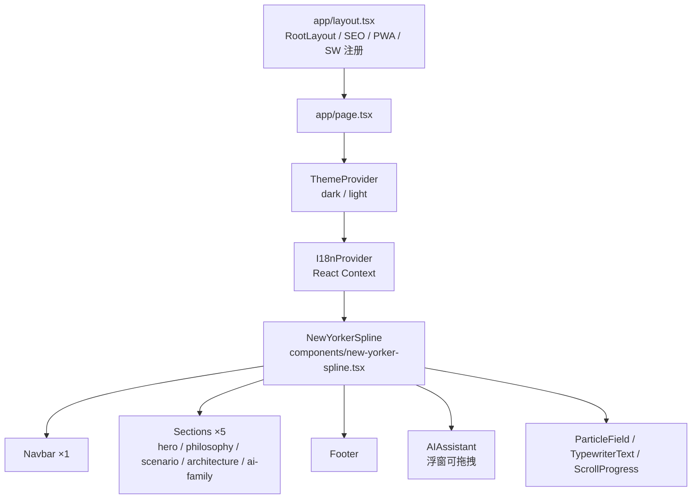
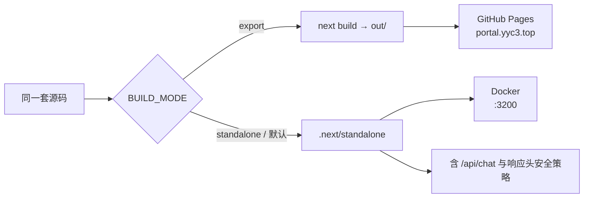
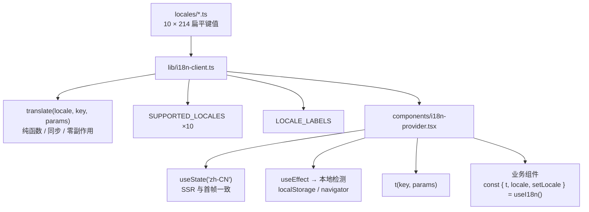
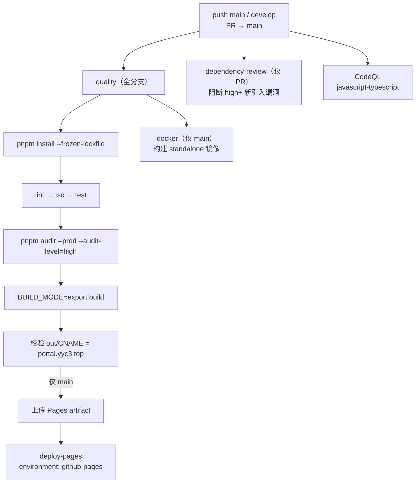
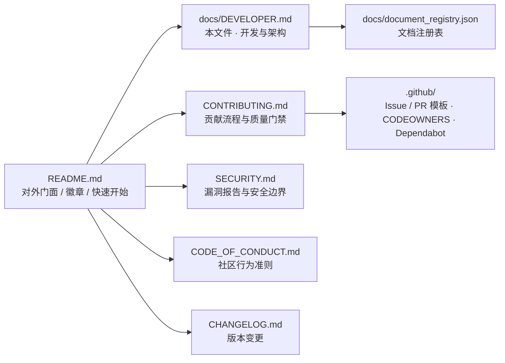

<div align="center">

# 🧊 YYC³ Nexus Portal · 开发者指南

**言启象限 · 语枢未来**

*Words Initiate Quadrants, Language Serves as Core for Future*

*万象归元于云枢 · 深栈智启新纪元*

</div>

---

## 一、项目概览

YYC³ Nexus Portal 是 YYC³ AI Family 的 3D 沉浸式智能交互门户。核心特征：

- **双模式构建**：一套代码同时产出 GitHub Pages 静态站（`output: "export"`）与 Docker standalone 服务
- **自研纯函数 i18n**：10 种语言 × 214 键，零运行时引擎依赖，SSR/客户端输出一致
- **AI 浮窗**：Ollama / OpenAI 兼容接口 + SSE 流式；静态站自动降级为本地模拟响应
- **PWA**：Service Worker 三种缓存策略 + 完整 manifest

> **代码为准绳**：本文档所有版本号、测试数量、路径均取自当前仓库实际状态。

---

## 二、技术栈

| 技术 | 实际版本 | 用途 |
| ------ | --------- | ------ |
| Next.js | 16.4.2 | App Router + Static Export / Standalone（构建使用 `--webpack`） |
| React | 19.2.7 | UI 渲染（Client Components + 动态导入） |
| TypeScript | 6.0.3 | strict mode + bundler resolution |
| Tailwind CSS | 4.2.4 | 原子化 CSS + CSS 变量双主题 |
| shadcn/ui + Radix UI | 59 个组件 / 27 个 Radix 原语 | 无障碍组件基础 |
| Framer Motion | 12.40.0 | 视差 / 粒子 / 打字机动画 |
| Spline | `@splinetool/react-spline` | 3D Hero 场景 |
| Zod | 4.4.3 | API 输入 Schema 校验 |
| Ollama | qwen3:32b（可选） | 本地 LLM 推理 |
| Vitest + jsdom | 5.0.5 / 30.1.3 | 单元与组件测试 |
| pnpm | 10.34.7（`packageManager` 锁定） | 包管理 |

**运行环境要求**：Node.js `>=22 <23`、pnpm `>=10`（见 `package.json#engines`）。

---

## 三、架构与页面组装

### 3.1 组件组装链路



`app/page.tsx` 为客户端入口，`app/layout.tsx` 为服务端布局（元数据与 PWA 注入）。

### 3.2 双构建模式



| 能力 | Standalone / Docker | GitHub Pages（静态导出） |
| ------ | -------------------- | ------------------------ |
| `/api/chat` 服务端代理 | ✅ 可用 | ❌ 不存在（POST 返回 405） |
| AI 对话 | ✅ 真实 SSE 流式 | ⚠️ 自动降级为本地模拟响应 |
| CSP / HSTS / X-Frame-Options 响应头 | ✅ `next.config.ts` 注入 | ⚠️ 平台不支持自定义响应头；仅 HTML `<meta>` CSP 兜底 |
| `frame-ancestors` | ✅ | ❌ meta 形式不支持该指令 |
| `/_vercel/insights` 分析 | ✅ 渲染 | ⛔ 已按构建模式关闭（避免 404） |
| 图片优化 | ✅ avif/webp | ⚠️ `unoptimized` |

> 静态模式的 CSP 兜底通过 `app/layout.tsx` 注入 `<meta http-equiv="Content-Security-Policy">`，
> 指令集与 `lib/csp.ts` 共用同一常量，避免配置漂移。

---

## 四、项目结构

```
YYC3-Nexus-Portal/
├── app/
│   ├── api/chat/route.ts         # Ollama SSE 代理（限流 + Zod 校验）
│   ├── globals.css               # Tailwind v4 + 主题变量 + 安全区
│   ├── layout.tsx                # 根布局（元数据 / PWA / SW / 静态 CSP 兜底）
│   ├── page.tsx                  # 客户端入口（Theme → I18n → 主页面）
│   ├── robots.ts                 # robots.txt
│   └── sitemap.ts                # sitemap.xml
├── components/
│   ├── new-yorker-spline.tsx     # 主页面组装
│   ├── ai-assistant/             # AI 浮窗
│   │   ├── AIAssistant.tsx
│   │   ├── components/           # 14 个子组件（含 FloatingButton / ChatPanel / SettingsPanel）
│   │   ├── hooks/                # 6 个 Hook（useChat / useAIConfig / useModelProvider 等）
│   │   ├── constants/            # 命令与提示词数据
│   │   └── types.ts
│   ├── sections/                 # hero / philosophy / scenario / architecture / ai-family / footer
│   ├── layout/navbar.tsx         # 导航栏（毛玻璃 + 移动菜单 + 语言切换）
│   ├── i18n-provider.tsx         # i18n Context
│   ├── theme-provider.tsx        # 主题 Context
│   └── ui/                       # 59 个 shadcn/ui 组件
├── lib/
│   ├── i18n-client.ts            # 纯函数翻译 + 语言注册
│   ├── csp.ts                    # CSP 指令单一源
│   └── utils.ts                  # cn() 等工具
├── locales/                      # 10 语言，各 214 键
├── __tests__/                    # 7 个测试文件，167 用例
├── public/
│   ├── sw.js                     # Service Worker（3 种缓存策略）
│   ├── manifest.json             # PWA 清单
│   └── yyc3-dist/                # 品牌图标集
├── docs/                         # 开发者文档 + 文档注册表
├── .github/workflows/            # ci.yml + codeql.yml
├── next.config.ts                # 双模式输出 + 安全头
├── vitest.config.ts              # 测试与覆盖率配置
├── Dockerfile / docker-compose.yml
└── public/CNAME                  # portal.yyc3.top（Pages 自定义域名）
```

---

## 五、快速开始

```bash
# 前置：Node.js 22.x、pnpm 10.x
pnpm install

pnpm dev                        # 开发服务器（3000 起，冲突自动递增）
pnpm build                      # Standalone 生产构建
BUILD_MODE=export pnpm build    # 静态导出到 out/
pnpm start                      # 启动 standalone 服务
```

指定端口（YYC³ 规范：开发 3030 起）：

```bash
PORT=3030 pnpm dev
```

启动本地 Ollama（可选）：

```bash
ollama pull qwen3:32b
ollama serve    # 默认 http://localhost:11434
```

仓库地址：`https://github.com/YYC-Cube/YYC3-Nexus-Portal.git`

---

## 六、国际化体系

### 6.1 数据链路



### 6.2 设计原则

| 原则 | 实现 |
| ------ | ------ |
| SSR 安全 | `translate()` 为纯函数，无全局状态 |
| 零 Hydration 风险 | 初始 state 固定 `zh-CN`，挂载后再检测用户偏好 |
| 扁平键查找 | 无需嵌套转换，O(1) 字典命中 |
| fallback 链 | 当前语言 → `zh-CN` → 返回 key 本身 |

### 6.3 键分布（权威源 `locales/zh-CN.ts`，共 214）

| 命名空间 | 键数 | 用途 |
| ---------- | ------ | ------ |
| `nav.*` | 5 | 导航 |
| `hero.*` | 7 | 首屏 |
| `philosophy.*` | 35 | 理念区（4 组 × 5 项 + 统计） |
| `scenario.*` | 12 | 应用场景 |
| `architecture.*` | 91 | 架构区（4 Tab × 5 卡片 × 4 字段 + 描述） |
| `ai.*` | 55 | AI 浮窗 |
| `family.*` | 3 | AI 成员 |
| `footer.*` | 5 | 页脚 |
| `lang.*` | 1 | 语言切换 |

### 6.4 新增翻译流程

```bash
# 1) 在权威源新增键
#    locales/zh-CN.ts
# 2) 按同一键序同步 9 种语言
# 3) 校验：键集必须与 zh-CN 完全一致
pnpm test -- __tests__/i18n.test.ts
```

`__tests__/i18n.test.ts` 已收紧为**完全对齐**断言：任一语言缺键、多键或空值都会使 CI 失败。

品牌与技术专有名词（`YYC³`、`Next.js`、`Spline`、`K8s`、`RBAC/ABAC`、`SLA`、`QPS` 等）在所有语言中保持原文。

---

## 七、核心模块

### 7.1 五维架构组件

`components/sections/architecture.tsx`

- 4 个 Tab：五高架构 / 五标体系 / 五化转型 / 五维评估
- 20 张可展开卡片，每张含标题、副标题、描述、6 个标签
- 响应式：移动 1 列 → 平板 2 列 → 桌面 5 列

### 7.2 AI 浮窗

`components/ai-assistant/`

- 可拖拽浮窗，4 种形态：浮动 / 最大化 / 全屏（移动端）
- 4 个标签页：对话 / 命令 / 提示词 / 配置
- 模型管理：扫描 Ollama / 手动添加 / 测试连接
- `useChat.ts`：`fetch('/api/chat')` 非 2xx 或网络异常时进入 `generateMockResponse()` 降级

### 7.3 PWA

`public/sw.js`

- 三种策略：CacheFirst（静态资源）/ NetworkFirst（导航与 API）/ StaleWhileRevalidate
- 预缓存使用逐项 `put` 而非 `addAll`，单条失败不会导致 SW 安装整体失败
- 自动注册 + 版本更新检测

### 7.4 移动端

安全区 `env(safe-area-inset-*)`、44px 最小触摸目标、滚动惯性、`text-size-adjust`、渐进式字号。

---

## 八、配置说明

### 8.1 `next.config.ts`

| 配置项 | 说明 |
| -------- | ------ |
| `output` | `BUILD_MODE=export` → `export`；生产 → `standalone`；开发 → 默认 |
| `trailingSlash` | 静态导出时启用，匹配 Pages 目录式路由 |
| `headers()` | 静态导出返回空数组（平台限制）；standalone 注入完整安全头 |
| `images` | avif / webp；静态导出 `unoptimized` |
| `poweredByHeader` | `false` |

### 8.2 端口规范

| 环境 | 端口 | 说明 |
| ------ | ------ | ------ |
| 开发 | 3030+ | YYC³ 团队规范，冲突自动递增 |
| 生产（Docker） | 3200 | `docker-compose` 暴露端口 |
| 容器内部 | 3200 | `ENV PORT` / `EXPOSE` |
| Ollama | 11434 | 本地推理服务 |

---

## 九、测试与质量门禁

```bash
pnpm lint                      # ESLint：0 errors
pnpm exec tsc --noEmit         # 类型检查：0 errors
pnpm test                      # Vitest：167 passed
pnpm run audit:prod            # 生产依赖安全门禁（脚本内置官方源）
pnpm build                     # standalone 构建
BUILD_MODE=export pnpm build   # 静态导出构建
```

| 测试文件 | 用例数 | 覆盖范围 |
| ---------- | -------- | ---------- |
| `i18n.test.ts` | 53 | 10 语言键集完全对齐 + key 结构 + translate |
| `ai-assistant.test.tsx` | 58 | 常量 / Hooks / 子组件 / 国际化 |
| `core.test.ts` | 18 | i18n 客户端 + 翻译函数 + 边界 |
| `api.test.ts` | 11 | Zod Schema 与请求校验 |
| `ratelimit.test.ts` | 11 | 限流逻辑 |
| `components.test.tsx` | 9 | 主题 / Provider / 工具函数 |
| `architecture.test.tsx` | 7 | 架构区渲染 + i18n 集成 |

**合计：7 个文件 / 167 用例。**

---

## 十、CI/CD



- 工作流级权限收敛为 `contents: read`，`pages: write` / `id-token: write` 仅在部署作业内提升
- `main` 分支并发不取消（保证部署顺序），其它分支取消进行中的旧运行
- 依赖更新由 `.github/dependabot.yml` 每周提交 PR；`braces` 因上游无补丁版本被显式忽略

---

## 十一、依赖安全现状

| 范围 | 漏洞数 | 说明 |
|------|--------|------|
| 生产依赖 | **0** | `pnpm audit --prod --audit-level=high` 通过 |
| 全量（含 dev） | 1 | `braces`（无上游修补版本，仅存在于开发工具链） |

已通过 `pnpm.overrides` 收敛：`@babel/core`、`browserslist`、`baseline-browser-mapping`、`js-yaml`、`source-map-js`。

---

## 十二、已知限制

| 限制 | 原因 | 影响 |
| ------ | ------ | ------ |
| Pages 无自定义响应头 | GitHub Pages 平台能力 | 仅 `<meta>` CSP 可用，`frame-ancestors` 无法生效 |
| Pages 上 `/api/chat` 返回 405 | 静态导出不含 API Route | AI 对话降级为模拟响应，功能可演示不可推理 |
| 静态模式无图片优化 | `images.unoptimized` | 依赖构建期产物体积控制 |
| `braces` 仍被审计标记 | 上游无补丁版本 | 仅开发期工具链，不进运行时 |

---

## 十三、文档体系



---

<div align="center">

**© 2025-2026 YanYuCloudCube Team. All Rights Reserved.**

*言启千行代码，语枢万物智能*

*Words Initiate Thousands of Lines of Code, Language Pivots the Intelligence of All Things*

<admin@0379.email> · [portal.yyc3.top](https://portal.yyc3.top)

</div>
